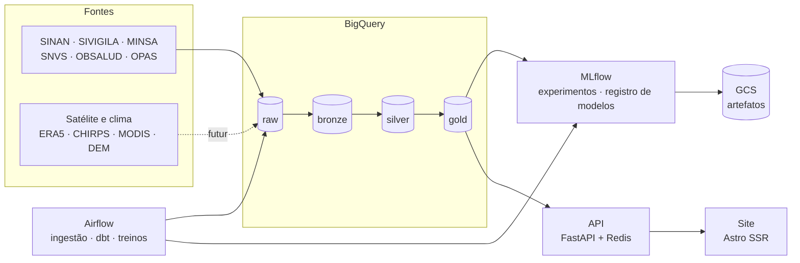

# Atlas Epidemiológico da Dengue

<!-- Os badges de release e docker mostram "no releases" / "repo not found" até a primeira
     versão (tag v1.0) e a publicação das imagens; o de CI, até o workflow ci.yml existir. -->
[](https://github.com/cnx-anselmooliveira/atlas_epidemiologico/actions/workflows/ci.yml)
[](https://github.com/cnx-anselmooliveira/atlas_epidemiologico/releases)
[](https://hub.docker.com/r/anselmomendes/atlas-epidemiologia-ml)
[](LICENSE)

Plataforma aberta de vigilância e previsão da dengue na América do Sul. Ela reúne os dados oficiais de notificação, modela as séries em camadas, treina e rastreia modelos de previsão e publica indicadores por país, região e município.

## Sobre

O objetivo científico é construir uma **"impressão digital ambiental"** de cada região, combinando relevo, clima (temperatura, chuva, umidade, vento), vegetação e uso do solo. Essa impressão é cruzada com a modelagem de nicho ecológico do *Aedes aegypti* para estimar o risco de dengue sem depender só das estatísticas oficiais de casos, que variam muito de qualidade entre países.

**Estado atual:**
- Plataforma de ML (MLflow + Airflow) rodando localmente.
- Modelos de previsão de incidência por UF do Brasil em desenvolvimento: baseline bayesiano, CatBoost, LSTM, SVR, Chronos e ensemble.
- Pipeline de dados em migração para BigQuery + dbt.
- Site público em reconstrução com Astro.

O planejamento de cada parte está em [`openspec/changes/`](openspec/changes/).

## Arquitetura



O Airflow orquestra a ingestão, o dbt e os treinos. O MLflow rastreia experimentos e versiona modelos, com os artefatos no Google Cloud Storage. A API lê a camada gold e o site publica os indicadores. Tudo roda em containers, publicados no DockerHub pelo GitHub Actions e implantados pelo Portainer.

## Começo rápido

Pré-requisitos: Docker Desktop, Git, PowerShell e [uv](https://docs.astral.sh/uv/).

```powershell
git clone https://github.com/cnx-anselmooliveira/atlas_epidemiologico.git
cd atlas_epidemiologico
./platform/dev.ps1 up        # na 1ª vez cria .env (a partir do .env.example); preencha as senhas e rode de novo
./platform/dev.ps1 status    # aguarde todos "healthy"
```

| Serviço | Endereço |
|---|---|
| MLflow | <http://127.0.0.1:5000> |
| Airflow | <http://127.0.0.1:8080> (usuário `admin`) |
| JupyterLab (opcional, `./platform/dev.ps1 notebook`) | <http://127.0.0.1:8888> |

No Airflow, dispare a DAG `atlas_dengue_forecast_br` e veja as runs no MLflow. O passo a passo completo, inclusive o uso do bucket GCS e da rede corporativa, está em [`platform/README.md`](platform/README.md).

## Estrutura do repositório

| Pasta | O que tem |
|---|---|
| [`ml/`](ml/README.md) | Pacote Python `atlas_ml`: CLI `atlas-ml`, treinos, leitura do BigQuery, promoção de modelos e testes |
| [`airflow/`](airflow/README.md) | Imagem do Airflow e DAGs (`airflow/dags/`), incluindo o projeto dbt [`airflow/dags/utfpr_dengue/`](airflow/dags/utfpr_dengue/README.md) (bronze, silver e gold no BigQuery) |
| [`infra/mlflow/`](infra/mlflow/README.md) | Imagem do servidor MLflow (Postgres + GCS, autenticação na VPS) |
| [`platform/`](platform/README.md) | Compose de desenvolvimento local (Postgres, MLflow, Airflow, Jupyter) |
| [`deploy/`](deploy/) | Stacks do Portainer para homologação e produção (em construção) |
| [`frontend/`](frontend/README.md) | Site em Astro (em reconstrução) |
| [`docs/`](docs/) | Referências e levantamentos ([modelos do ESA-UNICEF](docs/referencias/esa-unicef-dengue-forecast.md)) |
| [`openspec/`](openspec/) | Mudanças planejadas: proposta, specs, design e tarefas |

## Fluxo de desenvolvimento

| Etapa | Branch | Tag da imagem | Onde roda |
|---|---|---|---|
| Desenvolvimento | `dev` | `dev` | máquina local |
| Homologação | `hml` (PR de `dev`) | `hml` | VPS, stacks `hml` |
| Produção | `main` (PR de `hml`) + tag `vX.Y` | `X.Y` | VPS, stacks `prod` |

Mudanças de comportamento são planejadas com [OpenSpec](openspec/) antes de implementar. Commits são feitos por assunto, e os pull requests para `hml` e `main` passam por todos os testes. Veja [`CONTRIBUTING.md`](CONTRIBUTING.md).

## Dados

O Atlas usa dados públicos de vigilância epidemiológica:

| País | Fonte |
|---|---|
| Brasil | SINAN (Ministério da Saúde), via Base dos Dados |
| Colômbia | SIVIGILA (INS) |
| Peru | CDC-MINSA (dados abertos) |
| Argentina | SNVS / Boletim Integrado de Vigilância |
| Equador | SIVE-ALERTA / OBSALUD |
| Américas e Bolívia | OPAS (PLISA, Portal ARBO) |

**Os dados não são redistribuídos neste repositório.** Eles são carregados no BigQuery a partir das fontes e seguem os termos de uso de cada uma. Ao usar os resultados, cite também as fontes originais.

## Como citar

Use o botão **"Cite this repository"** do GitHub, gerado a partir do [`CITATION.cff`](CITATION.cff).

## Licença

Código e documentação sob a [licença MIT](LICENSE) © 2026 UTFPR - Atlas Epidemiológico.

Leia também o [código de conduta](CODE_OF_CONDUCT.md) e a [política de segurança](SECURITY.md).
